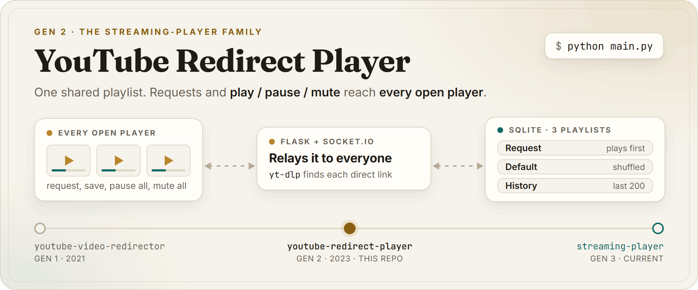
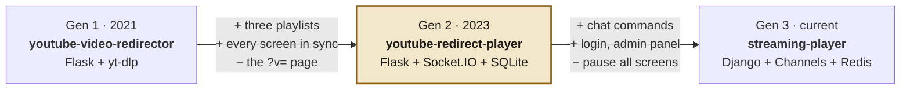
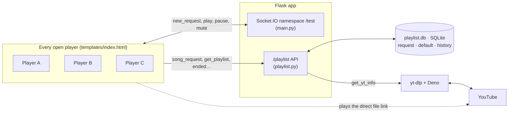
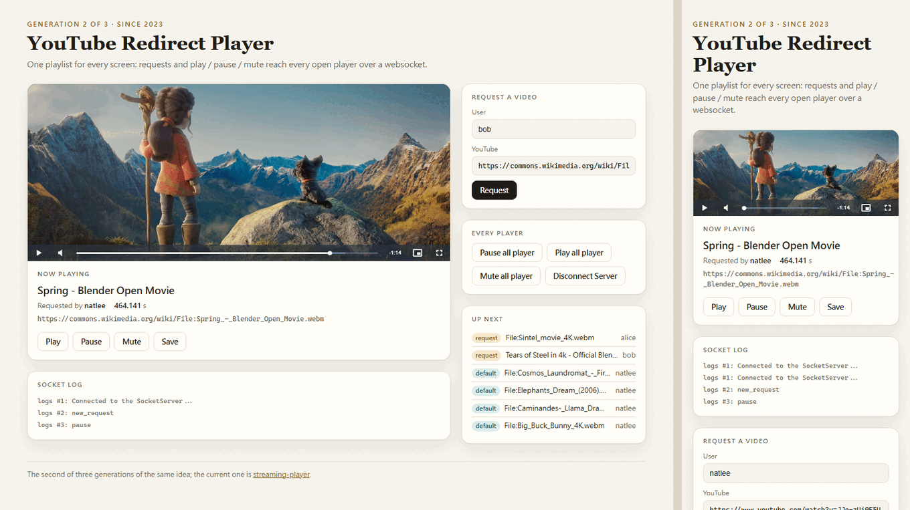

<p align="center">
  <picture>
    <source media="(prefers-color-scheme: dark)" srcset="https://raw.githubusercontent.com/NatLee/youtube-redirect-player/main/docs/images/hero-dark.png">
    
  </picture>
</p>

<p align="center">
  <a href="https://github.com/NatLee/youtube-redirect-player/actions/workflows/ci.yml"></a>
  
  <a href="https://github.com/NatLee/streaming-player"></a>
  
</p>

> [!IMPORTANT]
> **This project is retired.** It is the second of three generations of the same idea, and the one
> that lives on is **[streaming-player](https://github.com/NatLee/streaming-player)**. Use that one.
> This repo stays as a working museum piece: the final version below runs, has tests and CI, and
> won't get new features.

YouTube Redirect Player is a small Flask app that turns any number of browser tabs into one player.
You request a video by its YouTube link, [yt-dlp](https://github.com/yt-dlp/yt-dlp) finds the
video's direct file link, and the page plays that file. The playlist lives in SQLite, and
[Socket.IO](https://socket.io/) (a websocket library) carries every request and every play, pause
and mute to all open players. Open it on a laptop and a TV, and both follow along.

## The family tree

Three repos, one idea that kept growing. Each generation added something and let something go.



| | Gen 1 | Gen 2 | Gen 3 |
|---|---|---|---|
| In one line | One video per URL | One shared playlist on every open screen | A stream player your chat controls |
| Added | `/?v=<id>` finds the direct link and plays it | Request, default and history playlists; play, pause and mute on every screen at once | Nightbot chat commands, login, admin panel, a queue with favorite and block marks, Swagger |
| Let go | Nothing yet, it was the first | The one-video `?v=` page and the visible direct link | Pause and mute for every screen at once |

You are looking at Gen 2. Gen 1 is
[youtube-video-redirector](https://github.com/NatLee/youtube-video-redirector); Gen 3 is
[streaming-player](https://github.com/NatLee/streaming-player).

## What it solved

Gen 1 could play exactly one video: the one in the address bar. This generation answers the next
question, "what plays after that, and on which screen?" It keeps a queue, lets people put videos in
it by name, and fills the gaps with a shuffled list of saved favourites. Because the queue and the
controls travel over a websocket, you can play anywhere: every open page hears about a new request,
and one button pauses them all.

## How it works



The playlist has three tables:

| Playlist | What it holds | 中文（原本的說明） |
|---|---|---|
| `RequestPlaylist` | Videos people asked for. They play first, in the order they came in. | 請求播放清單，使用者當下點的影片 |
| `DefaultPlaylist` | Videos someone saved with the Save button. After the requests, the player plays up to 200 of them, shuffled. | 預設播放清單，裏面有先前存下的影片 |
| `HistoryPlaylist` | Videos that finished playing, the newest 200. | 歷史播放清單，曾經播過的影片，最大儲存 200 筆 |

A request goes like this: the page calls `/playlist/song_request`, the server asks yt-dlp about the
video and stores it in the request playlist, and the page announces `new_request` over the socket.
Every player adds it to its queue, ahead of the saved videos but behind the one on screen. When a
video ends, the player records it with `/playlist/ended`, drops it with `/playlist/remove_request`
and asks yt-dlp for the next one's direct link.

### The API

Everything is a `GET` with query parameters, so you can try it from the address bar.

| Route | What it does |
|---|---|
| `/` | The player page. |
| `/pause` | Pauses every open player. |
| `/playlist/song_request?user=&url=` | Requests a video. Answers its info, or `[]` if it is already requested or yt-dlp can't get it. |
| `/playlist/get_playlist` | Requests first, then up to 200 shuffled saved videos. |
| `/playlist/get_request_playlist` | Just the requests. |
| `/playlist/get_yt_info?v=` | yt-dlp's answer for one video: title, duration, page link, direct file link, file type. 502 with the reason when yt-dlp fails. |
| `/playlist/add_now_video_to_default_playlist?user=&url=&duration=` | Saves a video to the default playlist. |
| `/playlist/ended?user=&url=&duration=` | Records a finished video in the history. |
| `/playlist/remove_request?url=` | Drops a video from the requests. |
| `/playlist/queue` | A test route: the info of a random video from a built-in list. |

Routes that need a video answer 400 without one. A request without `user` is filed under
`anonymous`, the same name the page uses.

## Run the final version

### With Docker

```bash
git clone https://github.com/NatLee/youtube-redirect-player.git
cd youtube-redirect-player
docker build -t youtube-redirect-player .
docker run --rm -p 5000:5000 -v youtube-redirect-player-data:/data youtube-redirect-player
```

Or in one line, straight from GitHub without cloning:

```bash
docker run --rm -p 5000:5000 -v youtube-redirect-player-data:/data $(docker build -q https://github.com/NatLee/youtube-redirect-player.git)
```

Then open <http://localhost:5000/> in two windows, request a video in one, and watch it show up in
both. (In 2026, use a link that still plays in a browser, such as a Wikimedia Commons video page;
see [Status in 2026](#status-in-2026-what-still-works).) The playlists live in the `youtube-redirect-player-data` volume, so they survive a restart.
The image runs gunicorn (a production web server) with one worker and many threads, which is how
Flask-SocketIO runs under gunicorn, as a non-root user.

### Without Docker

You need Python 3.11 or newer (tested with 3.12).

```bash
python -m venv .venv
source .venv/bin/activate        # Windows: .venv\Scripts\activate
pip install -r requirements.txt
python main.py
```

That starts the development server on `0.0.0.0:5000` with debug on, as it always did, and keeps the
playlists in `./playlist.db`. Run it from a terminal: Flask-SocketIO refuses to start its
development server when there is no terminal attached (under a service manager, say). Use the
Docker image for that.

### Settings

| Variable | Default | What it does |
|---|---|---|
| `PLAYLIST_DB` | `./playlist.db` (`/data/playlist.db` in Docker) | Where the SQLite file lives. A file from the first version opens fine. |
| `SECRET_KEY` | a new random key at every start | Signs the session cookie. |
| `HOST`, `PORT` | `0.0.0.0`, `5000` | Where `python main.py` listens. Port 5000 taken (macOS uses it for AirPlay)? `PORT=5001`. |

### Tests

```bash
docker build --target test .
```

That runs the pytest suite (34 tests) inside the same image the app ships in, so you don't need
Python on your machine. yt-dlp is faked; nothing talks to YouTube. The tests cover the database
(including the history limit), every API route, `/pause` and the websocket broadcast. CI runs the
same build, then starts the container and checks the page, the API and the Socket.IO handshake.

## Status in 2026: what still works

Checked on 2026-11-04 with the final version in Docker and two headless Edge windows:

- **The player part works.** Requests, the three playlists, the queue order, the history limit, and
  play, pause and mute across windows all behave as described above. The socket runs over a real
  websocket.
- **yt-dlp found YouTube links at first,** with the right title and duration, but **YouTube did
  not stream them to the browser.** The player says "The media could not be loaded"; Edge blocks
  the reply as `ERR_BLOCKED_BY_ORB`, which means YouTube answered with something other than video.
- **YouTube then stopped handing out links, too.** After about fifteen lookups in forty minutes from
  the same machine, it answered "Sign in to confirm you're not a bot". A request then comes back as
  `[]`, and `get_yt_info` answers 502 with that message.
- **Other sites yt-dlp knows still play end to end.** The screenshot below runs on Blender's open
  movies from Wikimedia Commons.

When YouTube changes how it hands out formats, a newer yt-dlp is usually the fix: bump the
`yt-dlp[default,deno]` line in [`requirements.txt`](requirements.txt) to the latest release and
rebuild.

## Then and now

<p align="center">
  <picture>
    <source media="(prefers-color-scheme: dark)" srcset="https://raw.githubusercontent.com/NatLee/youtube-redirect-player/main/docs/images/screenshot-dark.png">
    
  </picture>
</p>
<p align="center"><sub>The final version in Docker, in two windows at once: bob's request and "Pause all player" from the big one reached the small one too.<br>The queue is made of Blender's open movies on Wikimedia Commons, because YouTube's own links no longer play in a browser (see above).<br>Spring © Blender Foundation, <a href="https://creativecommons.org/licenses/by/4.0/">CC BY 4.0</a>.</sub></p>

<p align="center">
  
</p>
<p align="center"><sub>The page as it shipped in 2023: the same buttons, no styling.</sub></p>

## Credits

- Built on [youtube-video-redirector](https://github.com/NatLee/youtube-video-redirector), Gen 1.
- [yt-dlp](https://github.com/yt-dlp/yt-dlp) finds the links, [Video.js](https://videojs.com/) plays
  them, and [Flask-SocketIO](https://github.com/miguelgrinberg/Flask-SocketIO) keeps the screens in
  step.
